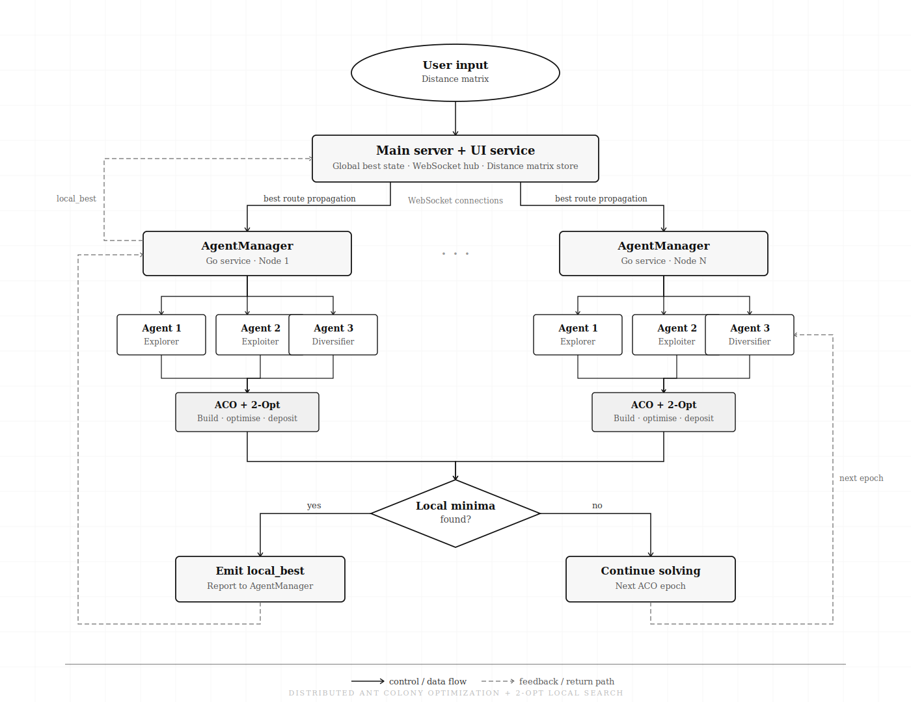

## AgentManager

It is a distributed system for solving the Traveling Salesperson Problem (TSP) with multiple agent(6) and each agent has different types of characteristics which makes exploration and exploitation.

## Architecture



## Setup

```bash
go run main.go
```

Spinup docker container

```bash
sudo docker build -t agentmanager .
sudo docker run -p 8080:8080  agentmanager
```

## Test

```bash
npx wscat -c ws://localhost:8080/ws

>{"type":"start","matrix":[[0,29,20,21,16,31,100,12,4,31],[29,0,15,29,28,40,72,21,29,41],[20,15,0,15,14,25,81,9,23,27],[21,29,15,0,4,12,92,12,25,13],[16,28,14,4,0,16,94,9,20,16],[31,40,25,12,16,0,95,24,36,3],[100,72,81,92,94,95,0,90,101,99],[12,21,9,12,9,24,90,0,15,25],[4,29,23,25,20,36,101,15,0,35],[31,41,27,13,16,3,99,25,35,0]]}
```
